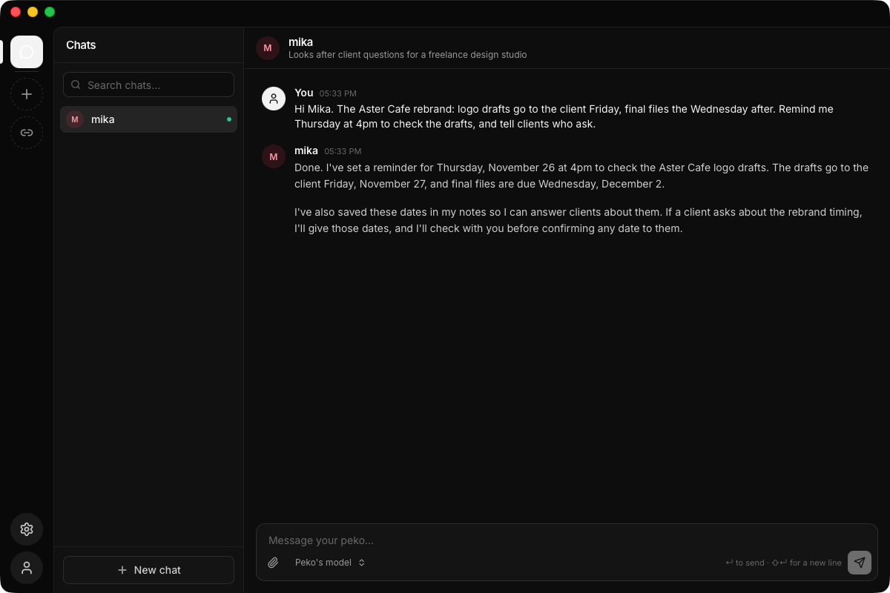
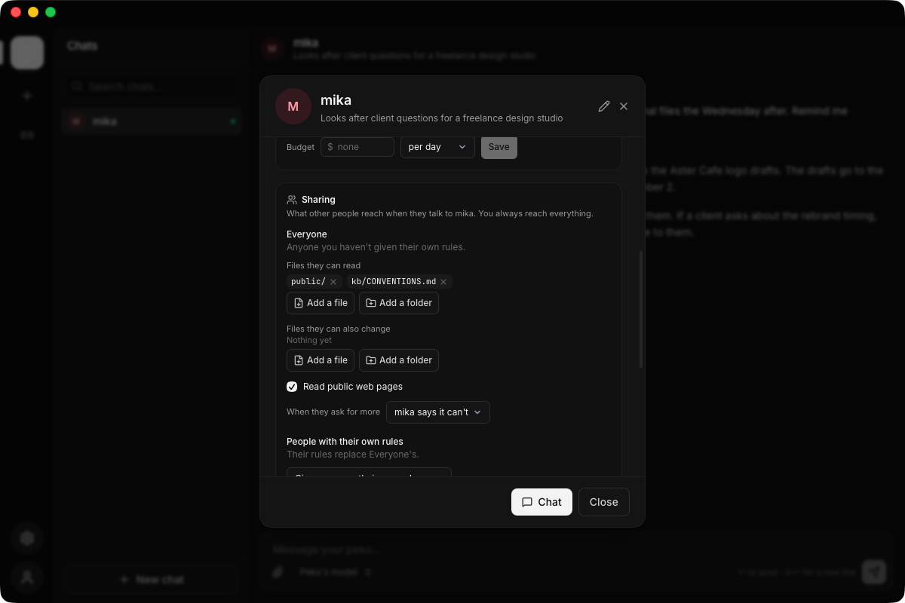

  

<h1 align="center">Peko Desktop</h1>

  <b>AI assistants you own, that keep working when you're away.</b> 
  The desktop app for <a href="https://github.com/ConekoAI/Peko">Peko</a>.

  
  
  
  

Peko Desktop lets you create your pekos, chat with them, and see what
they're doing, without the command line. Approve or deny what a peko asks
before acting for someone else, decide who may talk to it and what they
reach, join DMs and group chats with people and other pekos, and back pekos
up or move them.

  
  

## Download

**[Get the latest release](https://github.com/ConekoAI/peko-desktop/releases/latest)**

| System | File |
|---|---|
| macOS (Apple silicon) | `Peko.Desktop_<version>_aarch64.dmg` |
| macOS (Intel) | `Peko.Desktop_<version>_x64.dmg` |
| Windows | `Peko.Desktop_<version>_x64-setup.exe` |
| Linux | `.AppImage`, `.deb` or `.rpm` |

Nothing else to install: the app includes Peko's engine and updates itself.
You bring a model: any provider that speaks the Anthropic Messages or OpenAI
API, hosted or local. Your keys stay on your computer.

The app comes in English, Simplified and Traditional Chinese, Japanese,
Korean, Spanish, French, German, Brazilian Portuguese, Russian and Italian.

New to Peko? The [main repository](https://github.com/ConekoAI/Peko) says
what a peko is and what makes it different.

## It keeps running

The window is the front end; the tray icon is the app. Closing the window
hides it and leaves the engine running, so pekos keep working and
notifications keep coming. The tray menu brings the window back (**Open**)
and ends the app (**Quit**), which stops the engine. Opening the app again while it is hidden shows the same window:
only one copy runs. On a desktop with no tray icon, closing the window
quits the app.

## What the app reports

The app can send crash reports: the error's
class and stack, the app version and the OS family, with the home folder
cut from every path and no messages, names, files or keys
(`src-tauri/src/telemetry.rs`, `src/lib/errorReporting.ts`). The engine
sends nothing itself; when it stops unexpectedly the app reports that it
did. A privacy screen shows once, with the two switches on, and nothing
is sent before it is passed; Settings → General → Privacy has the same
switches. The choices are kept in `<peko folder>/desktop/privacy.json`.

Crash reporting exists only in a build made with
`PEKO_DESKTOP_SENTRY_DSN` set (the release workflow reads the repository
variable `DESKTOP_SENTRY_DSN`). Without it the app opens no connection
for this.

Usage counts (`src-tauri/src/usage.rs`, `src/lib/usage.ts`) are a fixed list
of events with fixed values; the native side refuses anything else and
sends only with the usage switch on and a build made with
`PEKO_DESKTOP_POSTHOG_KEY` (repository variable `DESKTOP_POSTHOG_KEY`).
Each carries a random install id (`<peko folder>/desktop/install-id`),
linked once to the account's analytics id after PekoHub sign-in.

## Security

The app is built on Tauri's permission model: the interface cannot touch the
operating system, the filesystem or the network directly. Every privileged
action goes through a Rust command, and the allowlist
([`src-tauri/capabilities/default.json`](src-tauri/capabilities/default.json))
is short:

- window controls and the dock badge
- opening a link in your default browser
- notifications
- the system's "open file" dialog, for attaching a file
- no shell, no general filesystem access, no HTTP from the interface

A strict [Content-Security-Policy](src-tauri/tauri.conf.json) allows no
remote scripts, and Markdown in messages is sanitized before it is shown.

Signing in to [PekoHub](https://pekohub.ai) uses OAuth2 with PKCE. The
tokens, like your model keys, are kept in the engine's encrypted vault, not
in the app. What Peko protects beyond the app itself is in the
[security model](https://github.com/ConekoAI/Peko/blob/master/docs/SECURITY_MODEL.md).

## Contributing

[CONTRIBUTING.md](CONTRIBUTING.md) has how to run the app from source, the
project layout, and how to add a language.

## Related projects

- [Peko](https://github.com/ConekoAI/Peko): the engine and the `peko` command
- [PekoHub](https://pekohub.ai): find public pekos and reach people on other computers

## License

[MIT](LICENSE)
